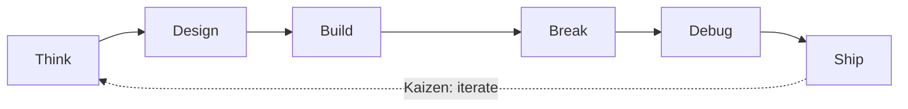

<div align="center">

# Tushar Kumar

### Creative Technologist · AI/ML Engineer · Full-Stack Developer

<a href="https://github.com/TusharKumar999">
  
</a>

<br/>

[](https://www.linkedin.com/in/tushar-kumar-11b667292/)
[](https://mail.google.com/mail/?view=cm&fs=1&to=rk20014290@gmail.com)


</div>

---

## `~/about`

```ts
const tushar: Engineer = {
  role:      "Creative Technologist",
  focus:     ["AI/ML Engineering", "Generative AI", "Full-Stack Systems"],
  education: "B.Tech CSE (AI) — final year",
  builds:    ["LLM-powered apps", "Real-time platforms", "Interactive experiences"],
  creates:   ["Games", "3D / Blender", "Visual tech"],
  philosophy: "Don't choose between engineering and creativity. Build at the intersection.",
  status:    "Open to SWE / AI Engineer roles & internships",
};
```

---

## `~/stack`

<div align="center">

| Domain | Technologies |
|:--|:--|
| **Languages** |    |
| **AI / ML** |     |
| **Frontend** |   |
| **Backend** |    |
| **Data** |   |
| **Creative** |   |
| **Tooling** |    |

</div>

---

## `~/featured-projects`

### ⚔️ Code Duel — 1v1 Real-Time Competitive Coding Arena
> Head-to-head coding battles with AI-generated problems and automated judging.

- **Problem generation:** Gemini produces fresh challenges on demand
- **Execution & verdicts:** Judge0 sandboxes and evaluates submissions against test cases
- **State & matchmaking:** Supabase handles persistence and real-time sync
- **Interface:** Streamlit front end

`Python` · `Streamlit` · `Gemini API` · `Judge0` · `Supabase`

### 🧠 Project-GenAI — Interview Prep & ATS Resume Assistant
> GenAI-powered tooling for interview preparation and ATS-oriented resume optimization.

`Python` · `LLMs` · `Prompt Engineering`

<!-- Add repo links: [Repo](https://github.com/TusharKumar999/<repo-name>) -->

---

## `~/engineering-workflow`



> **Kaizen** — every failure is a data point, every iteration a step forward.

---

## `~/github-analytics`

<div align="center">


</div>

---

## `~/currently`

- 🔭 Building production-style **LLM applications** and real-time systems
- 🌱 Deepening **NLP, Generative AI, and system design**
- 🧩 Sharpening **DSA** for competitive and interview performance
- 🎮 Exploring **game development & 3D** pipelines in Blender

---

## `~/connect`

<div align="center">

[](https://www.linkedin.com/in/tushar-kumar-11b667292/)
[](https://github.com/TusharKumar999)
[](https://mail.google.com/mail/?view=cm&fs=1&to=rk20014290@gmail.com)

```text
$ ./collaborate --open
> Open to: SWE roles · AI/ML projects · Game & creative-tech collabs
```


</div>
